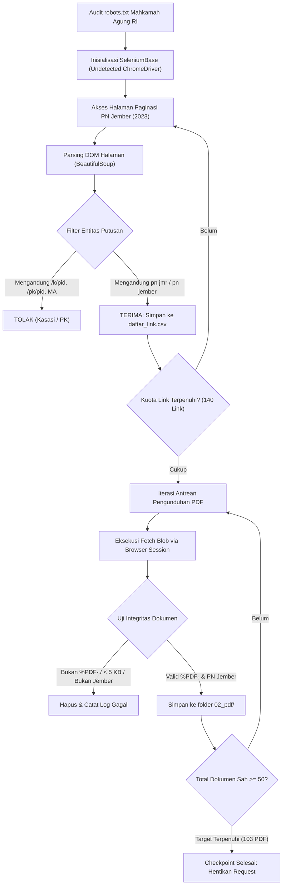

<p align="center">
  
</p>

<h1 align="center">📚 Dataset-Narkotika_406_441</h1>
<h3 align="center">Sistem Web Crawler & Information Extraction Direktori Putusan MA RI</h3>

<p align="center">
  <strong>Pengadilan Negeri Jember (PN Jmr)</strong><br>
  Direktori Pidana Khusus &bull; Klasifikasi Narkotika dan Psikotropika (Tahun 2023–2024)
</p>

<p align="center">
  
  
  
  
  
</p>

---

## 📋 Daftar Isi

- [📖 Tentang Dataset & Proyek](#-tentang-dataset--proyek)
- [👥 Informasi Kelompok](#-informasi-kelompok)
- [🌐 Sumber Data & Parameter Target](#-sumber-data--parameter-target)
- [📁 Struktur Repositori](#-struktur-repositori)
- [📊 Ringkasan Statistik & Perbandingan Dataset](#-ringkasan-statistik--perbandingan-dataset)
- [🛠️ Metodologi & Arsitektur Web Crawler (SUBCPMK-3)](#️-metodologi--arsitektur-web-crawler-subcpmk-3)
- [🔍 Validasi Ketat Tingkat Pertama PN Jember](#-validasi-ketat-tingkat-pertama-pn-jember)
- [📑 Information Extraction & Atribut Tabular (Regex Parser)](#-information-extraction--atribut-tabular-regex-parser)
- [⚡ Preprocessing & Inverted Indexing (SUBCPMK-4)](#-preprocessing--inverted-indexing-subcpmk-4)
- [🚀 Panduan Penggunaan (Google Colab & Lokal)](#-panduan-penggunaan-google-colab--lokal)
- [⚖️ Kepatuhan Etika Web Crawling & robots.txt](#️-kepatuhan-etika-web-crawling--robotstxt)
- [📜 Lisensi & Catatan Akademik](#-lisensi--catatan-akademik)

---

## 📖 Tentang Dataset & Proyek

Repository ini berisi kompilasi **dokumen putusan pengadilan tingkat pertama** dari **Pengadilan Negeri Jember (PN Jember)** dalam perkara **Pidana Khusus — Narkotika dan Psikotropika**, mencakup akuisisi **manual (5 putusan)** dan **otomatisasi web crawling skala penuh (103 putusan sah terverifikasi)**.

Dataset ini dikembangkan untuk memenuhi ketentuan tugas **Ujian Tengah Semester (UTS)** mata kuliah **Temu Kembali Informasi (Information Retrieval)**, Program Studi Informatika, Fakultas Teknik, Universitas Muhammadiyah Malang.

### Pemanfaatan Riset:
- 🔍 **Information Retrieval (IR)** — Sistem temu kembali dokumen hukum dan pencarian teks putusan.
- 📊 **Natural Language Processing (NLP)** — Named Entity Recognition (NER) dan Information Extraction (IE) istilah hukum pidana.
- 📈 **Text Mining & Legal Analytics** — Analisis pola pasal, tren tuntutan jaksa, dan amar putusan majelis hakim.

---

## 👥 Informasi Kelompok

| Peran | Nama Anggota | NIM |
|:---:|:---|:---:|
| **Anggota 1** | Akhmad Zamri Ardani | `202310370311406` |
| **Anggota 2** | Muchammad Rifqi Dzaki Arrafi | `202310370311441` |

> **Mata Kuliah:** Temu Kembali Informasi (TKI)  
> **Dosen Pengampu:** Galih W. W  
> **Program Studi:** Informatika &bull; Fakultas Teknik &bull; Universitas Muhammadiyah Malang  
> **Semester / Kelas:** 7 / D &bull; Tahun Ajaran 2026/2027

---

## 🌐 Sumber Data & Parameter Target

Seluruh dokumen bersumber secara legal dari portal resmi:
🔗 **[Direktori Putusan Mahkamah Agung Republik Indonesia](https://putusan3.mahkamahagung.go.id/)**

| Parameter | Spesifikasi |
|:---|:---|
| **Lembaga Peradilan** | Pengadilan Negeri Jember (`pn-jember`) |
| **Tingkat Pengadilan** | Pengadilan Tingkat Pertama (Menolak Kasasi & PK Mahkamah Agung) |
| **Klasifikasi / Kategori** | Pidana Khusus &rarr; Narkotika dan Psikotropika |
| **Tahun Register Perkara** | 2023 – 2024 |
| **Status Putusan** | Bukan berstatus *Berkekuatan Hukum Tetap* (BHT) |

---

## 📁 Struktur Repositori

```text
Dataset-Narkotika_406_441/
│
├── 📂 Dataset/
│   ├── Narkotika_Manual.zip        # Arsip 5 dokumen putusan PDF (akuisisi manual)
│   └── Narkotika_Crawling.zip      # Arsip 103 dokumen putusan PDF sah (hasil web crawler)
│
├── 📂 Overview/
│   ├── Overview_Manual.xlsx        # Spreadsheet ringkasan 5 putusan manual
│   └── Overview_Crawling.xlsx      # Spreadsheet rekapitulasi 103 putusan crawling (ekstraksi IE)
│
├── 📂 data/                        # Direktori korpus lengkap terstruktur
│   ├── 01_link/
│   │   └── daftar_link.csv         # 140 tautan perkara resmi PN Jember
│   ├── 02_pdf/                     # 103 berkas dokumen asli format .pdf
│   ├── 03_txt/                     # 103 berkas teks murni hasil ekstraksi .txt
│   ├── 04_hasil/
│   │   ├── hasil_ekstraksi.csv     # Dataset tabular 8 kolom hasil parsing Regex
│   │   └── Overview.xlsx           # Laporan rekap akademik format Excel
│   ├── 05_index/
│   │   ├── inverted_index.json     # Positional Inverted Index teks putusan
│   │   └── statistik_index.csv     # Statistik leksikon dan term frequency
│   └── log/
│       └── log_unduh.csv           # Catatan audit dan log pengunduhan dokumen
│
├── 📓 UTS_TKI_Tugas3_Crawler_Narkotika_PN_Jember_Colab.ipynb # Notebook eksekusi Google Colab (Cloud)
├── 📓 UTS_TKI_Tugas3_Crawler_Narkotika_PN_Jember.ipynb       # Notebook eksekusi lokal (Jupyter / VS Code)
├── 📓 UTS_TKI_Tugas4_Preprocessing_Indexing_PN_Jember.ipynb  # Notebook Preprocessing & Inverted Indexing
├── 📦 Narkotika.zip                                          # Arsip bundle dataset utama
└── 📄 README.md                                              # Dokumentasi komprehensif proyek
```

---

## 📊 Ringkasan Statistik & Perbandingan Dataset

| Metrik Evaluasi | Akuisisi Manual (Tugas 1) | Web Crawler Otomatis (Tugas 3) | Target Minimal Kuliah |
|---|:---:|:---:|:---:|
| **Metode Pengumpulan** | Penelusuran Browser Manual | SeleniumBase UC Mode (Otomatis) | Bebas |
| **Tautan Terdata** | 5 URL | **140 URL Putusan** | &ge; 50 URL |
| **Dokumen PDF Terunduh** | 5 Berkas | **103 Berkas Sah PN Jember** | &ge; 50 Berkas |
| **Validasi Magic Bytes `%PDF-`** | 100% Sah | **100% Sah (Ukuran > 5 KB)** | Wajib |
| **Validasi Entitas PN Jember** | 5 PN Jember | **103 PN Jember (0 Kasasi / PK)** | Wajib Tingkat Pertama |
| **Korpus Teks Terekstrak** | 5 Dokumen | **103 Dokumen (.txt)** | &ge; 50 Dokumen |
| **Ekstraksi Informasi (IE)** | Manual Typing | Regex Parser Otomatis | 6 Atribut Kunci |

---

## 🛠️ Metodologi & Arsitektur Web Crawler (SUBCPMK-3)

Arsitektur crawler dirancang adaptif terhadap proteksi Cloudflare WAF serta mematuhi etika perayapan data:



---

## 🔍 Validasi Ketat Tingkat Pertama PN Jember

Salah satu tantangan teknis dalam scraping Direktori Putusan MA RI adalah adanya tautan *widget* kasasi/PK yang sering terselip pada halaman pengadilan negeri. Sistem mengimplementasikan filter dua lapis:

1. **Filter Level URL & Label**:
   * Menolak pola: `r'(?:/k/pid|/pk/pid|\bpk/|\bk/)'` (Kasasi / Peninjauan Kembali Mahkamah Agung).
   * Memvalidasi nama peradilan: `r'pn[\s\._]*(?:jmr|jember)'`.
2. **Filter Level Konten Dokumen (PyMuPDF)**:
   * Membaca halaman pertama setiap PDF secara instan pada memori sebelum disimpan permanen.
   * Memverifikasi keberadaan frasa `Pengadilan Negeri Jember` dan memastikan ketiadaan klausul peradilan kasasi MA.

---

## 📑 Information Extraction & Atribut Tabular (Regex Parser)

Teks putusan diekstrak menggunakan ekspresi reguler (*Regular Expressions*) yang dikalibrasi khusus untuk struktur putusan hukum Indonesia:

| No | Atribut Ekstraksi | Pola / Deskripsi Regulasi |
|:---:|:---|:---|
| 1 | **Nomor Putusan** | Identifikasi nomor register perkara (contoh: `Nomor 356/Pid.Sus/2023/PN Jmr`) |
| 2 | **Lembaga Peradilan** | Klasifikasi yurisdiksi: `Pengadilan Negeri Jember` |
| 3 | **Nama Terdakwa** | Ekstraksi identitas terdakwa setelah frasa `Nama lengkap : ...` |
| 4 | **Barang Bukti** | Kompilasi daftar barang bukti narkotika (sabu, ekstasi, timbangan, HP) |
| 5 | **Tuntutan Pidana** | Tuntutan lamanya hukuman dari Jaksa Penuntut Umum (JPU) |
| 6 | **Amar Putusan** | Vonis akhir majelis hakim (pidana penjara, kurungan, dan denda) |

Hasil ekstraksi disimpan secara terstruktur pada `data/04_hasil/hasil_ekstraksi.csv` dan format visual `Overview/Overview_Crawling.xlsx`.

---

## ⚡ Preprocessing & Inverted Indexing (SUBCPMK-4)

Pada tahap lanjutan (`UTS_TKI_Tugas4_Preprocessing_Indexing_PN_Jember.ipynb`), korpus teks 103 putusan diolah melalui alur penemuan kembali informasi:
1. **Case Folding & Text Cleaning**: Pembersihan tanda baca, angka, dan karakter non-alfanumerik.
2. **Tokenization**: Pemecahan teks dokumen menjadi unit leksikon kata.
3. **Stopword Removal**: Eliminasi kata umum bahasa Indonesia dan istilah formalitas hukum berfrekuensi tinggi non-diskriminatif.
4. **Positional Inverted Index**: Pembentukan matriks indeks keterbalikan yang memetakan setiap term ke ID dokumen beserta offset posisi kemunculannya untuk mendukung *phrase query*.

---

## 🚀 Panduan Penggunaan (Google Colab & Lokal)

### A. Menjalankan di Google Colab (Sangat Direkomendasikan)
1. Buka berkas **[UTS_TKI_Tugas3_Crawler_Narkotika_PN_Jember_Colab.ipynb](UTS_TKI_Tugas3_Crawler_Narkotika_PN_Jember_Colab.ipynb)** di Google Colab.
2. Jalankan sel secara berurutan:
   * **Sel 1**: Setup environment & auto-install Google Chrome Linux + virtual display Xvfb.
   * **Sel 2**: Audit kepatuhan `robots.txt` direktori MA RI.
   * **Sel 3**: Deteksi storage Google Drive secara dinamis.
   * **Sel 4**: Pengumpulan link putusan (otomatis memanfaatkan checkpoint penyimpanan).
   * **Sel 5**: Verifikasi integritas 103 PDF sah PN Jember.
   * **Sel 6**: Konversi teks penuh dokumen PDF ke `.txt`.
   * **Sel 7**: Ekstraksi pola entitas hukum & ekspor rekapitulasi `Overview_Crawling.xlsx`.

### B. Menjalankan Secara Lokal
```bash
# 1. Kloning repository
git clone https://github.com/rifqidzaki/Dataset-Narkotika_406_441.git
cd Dataset-Narkotika_406_441

# 2. Siapkan virtual environment
python -m venv venv
venv\Scripts\activate      # Di Windows
# source venv/bin/activate  # Di Linux/macOS

# 3. Pasang pustaka pendukung
pip install seleniumbase beautifulsoup4 pandas pymupdf openpyxl

# 4. Jalankan Jupyter Notebook
jupyter notebook UTS_TKI_Tugas3_Crawler_Narkotika_PN_Jember.ipynb
```

---

## ⚖️ Kepatuhan Etika Web Crawling & robots.txt

Implementasi crawler ini tunduk pada norma etika penambangan data:
* **Audit robots.txt**: Sistem memverifikasi aturan `/direktori/` pada `https://putusan3.mahkamahagung.go.id/robots.txt`.
* **Polite Crawling Delay**: Interval jeda acak **8 hingga 12 detik** diterapkan pada setiap request untuk mencegah lonjakan beban (*server load*).
* **Smart Checkpoint & Caching**: Sistem secara cerdas menghentikan penarikan data ke server MA RI ketika kuota dokumen sah telah terpenuhi di penyimpanan lokal.
* **Tujuan Non-Komersial**: Data semata-mata dihimpun untuk keperluan penelitian akademik tugas Ujian Tengah Semester mata kuliah Temu Kembali Informasi.

---

## 📜 Lisensi & Catatan Akademik

* **Status Dokumen**: Berdasarkan Pasal 43 huruf a UU No. 28 Tahun 2014 tentang Hak Cipta, penerbitan dokumen putusan pengadilan adalah milik publik (*public domain*) dan terbuka untuk edukasi serta transparansi peradilan.
* **Kode Sumber**: Kode implementasi dilisensikan di bawah lisensi [MIT License](LICENSE).

---

<p align="center">
  <b>Universitas Muhammadiyah Malang &copy; 2026</b><br>
  Fakultas Teknik &bull; Program Studi Informatika
</p>
