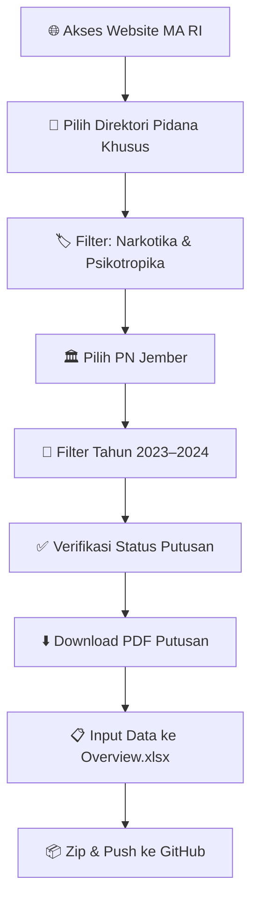

<p align="center">
  
</p>

<h1 align="center">📚 Dataset-Narkotika_406_441</h1>
<h3 align="center">Dataset Putusan Pengadilan — Narkotika & Psikotropika</h3>

<p align="center">
  <strong>Pengadilan Negeri Jember (PN Jmr)</strong><br>
  Direktori Pidana Khusus · Klasifikasi Narkotika dan Psikotropika
</p>

<p align="center">
  <a href="#tentang-dataset"></a>
  <a href="#sumber-data"></a>
  <a href="#lisensi"></a>
</p>

---

## 📋 Daftar Isi

- [Tentang Dataset](#tentang-dataset)
- [Informasi Kelompok](#informasi-kelompok)
- [Sumber Data](#sumber-data)
- [Struktur Repository](#struktur-repository)
- [Deskripsi Dataset](#deskripsi-dataset)
- [Ringkasan Statistik](#ringkasan-statistik)
- [Cara Penggunaan](#cara-penggunaan)
- [Metodologi Pengumpulan](#metodologi-pengumpulan)
- [Lisensi](#lisensi)

---

## 📖 Tentang Dataset

Repository ini berisi kumpulan **dokumen putusan pengadilan** dari **Pengadilan Negeri Jember** dalam kategori **Pidana Khusus — Narkotika dan Psikotropika**. Dataset ini dikumpulkan sebagai bagian dari tugas **Ujian Tengah Semester (UTS)** mata kuliah **Temu Kembali Informasi (Information Retrieval)** — Semester Ganjil 2026/2027, Fakultas Teknik, Universitas Muhammadiyah Malang.

Dataset ini dapat dimanfaatkan untuk berbagai keperluan penelitian di bidang:
- 🔍 **Information Retrieval** — Pencarian dan temu kembali dokumen hukum
- 📊 **Natural Language Processing (NLP)** — Ekstraksi informasi dari teks hukum
- 📈 **Text Mining** — Analisis pola putusan narkotika
- ⚖️ **Legal Analytics** — Studi sentimen dan tren putusan pengadilan

---

## 👥 Informasi Kelompok

| Peran | Nama | NIM |
|:---:|:---:|:---:|
| **Anggota 1** | Akhmad Zamri Ardani | 202310370311406 |
| **Anggota 2** | Muchammad Rifqi Dzaki Arrafi | 202310370311441 |

> **Mata Kuliah:** Temu Kembali Informasi (TKI)  
> **Dosen Pengampu:** Galih W. W  
> **Semester / Kelas:** 7 / A, D  
> **Tahun Ajaran:** Semester Ganjil 2026/2027

---

## 🌐 Sumber Data

Seluruh dokumen putusan bersumber dari **Direktori Putusan Mahkamah Agung Republik Indonesia**:

🔗 [https://putusan3.mahkamahagung.go.id/direktori.html](https://putusan3.mahkamahagung.go.id/direktori.html)

| Parameter | Nilai |
|:---|:---|
| **Direktori** | Pidana Khusus |
| **Klasifikasi** | Narkotika dan Psikotropika |
| **Pengadilan** | Pengadilan Negeri Jember (PN Jmr) |
| **Tahun Putusan** | 2023 – 2024 |
| **Status Putusan** | ❌ Bukan *Berkekuatan Hukum Tetap* |

---

## 📁 Struktur Repository

```
Dataset-Narkotika_406_441/
│
├── 📂 Dataset/
│   └── Narkotika.zip              # Arsip berisi 5 dokumen putusan (.pdf)
│
├── 📂 Overview/
│   └── Overview.xlsx              # Rekap ringkasan seluruh putusan
│
└── 📄 README.md                   # Dokumentasi repository (file ini)
```

### Detail Isi Folder

| Folder/File | Deskripsi |
|:---|:---|
| `Dataset/Narkotika.zip` | File arsip ZIP yang berisi seluruh dokumen putusan pengadilan dalam format PDF |
| `Overview/Overview.xlsx` | Spreadsheet berisi ringkasan data dari seluruh putusan, meliputi No Putusan, Lembaga Peradilan, Barang Bukti, dan Amar Putusan |
| `README.md` | Dokumentasi lengkap mengenai dataset, metodologi, dan cara penggunaan |

---

## 📑 Deskripsi Dataset

### Kolom pada Overview.xlsx

| Kolom | Tipe Data | Deskripsi |
|:---|:---|:---|
| `No` | Integer | Nomor urut dokumen |
| `No Putusan` | String | Nomor registrasi putusan pengadilan (contoh: `183/Pid.Sus/2023/PN Jmr`) |
| `Lembaga Peradilan` | String | Nama pengadilan yang mengeluarkan putusan |
| `Barang Bukti` | Text | Daftar barang bukti yang disita dalam perkara |
| `Amar Putusan` | Text | Isi amar/keputusan hakim terhadap terdakwa |

### Daftar Putusan

| No | No Putusan | Tahun | Terdakwa | Jenis Narkotika | Pidana Penjara |
|:---:|:---|:---:|:---|:---|:---|
| 1 | 183/Pid.Sus/2023/PN Jmr | 2023 | Misnali Bin Toliman | Sabu (0,09 g) | 6 tahun |
| 2 | 74/Pid.Sus/2023/PN Jmr | 2023 | Sugiono | Sabu (0,37 g + 0,7 g) | 5 tahun 6 bulan |
| 3 | 602/Pid.Sus/2024/PN Jmr | 2024 | Fendik Kurniawan | Sabu (0,08 g + 0,74 g) | 7 tahun |
| 4 | 531/Pid.Sus/2024/PN Jmr | 2024 | Moh. Sultan | Sabu (total 1,64 g) | 4 tahun 9 bulan |
| 5 | 651/Pid.Sus/2024/PN Jmr | 2024 | Mupet | Sabu (17,91 g) + Ekstasi (0,80 g) | 7 tahun |

---

## 📊 Ringkasan Statistik

```
📌 Total Dokumen     : 5 putusan
📌 Pengadilan        : PN Jember
📌 Rentang Tahun     : 2023 – 2024
📌 Jenis Narkotika   : Sabu-sabu, Ekstasi
📌 Rata-rata Pidana  : ~6 tahun 1 bulan
📌 Pidana Tertinggi  : 7 tahun (2 putusan)
📌 Pidana Terendah   : 4 tahun 9 bulan
📌 Denda Umum        : Rp 1.000.000.000,-
```

### Distribusi Tahun Putusan

| Tahun | Jumlah Putusan |
|:---:|:---:|
| 2023 | 2 |
| 2024 | 3 |

### Jenis Tindak Pidana

| Pasal / Jenis | Jumlah |
|:---|:---:|
| Perantara jual beli Narkotika Gol. I | 2 |
| Memiliki/menyimpan Narkotika Gol. I | 1 |
| Membeli Narkotika Gol. I | 1 |
| Menerima Narkotika Gol. I | 1 |

---

## 🚀 Cara Penggunaan

### 1. Clone Repository

```bash
git clone https://github.com/<username>/Dataset-Narkotika_406_441.git
cd Dataset-Narkotika_406_441
```

### 2. Ekstrak Dataset

```bash
cd Dataset
unzip Narkotika.zip
```

### 3. Buka Overview

Buka file `Overview/Overview.xlsx` menggunakan Microsoft Excel, Google Sheets, atau LibreOffice Calc untuk melihat ringkasan seluruh putusan.

### 4. Penggunaan dengan Python

```python
import pandas as pd

# Baca overview
df = pd.read_excel("Overview/Overview.xlsx")
print(df.head())

# Ekstrak teks dari PDF
import PyPDF2

with open("Dataset/putusan_183_pid.sus_2023_pn_jmr_20261113101732.pdf", "rb") as f:
    reader = PyPDF2.PdfReader(f)
    text = ""
    for page in reader.pages:
        text += page.extract_text()
    print(text[:500])
```

---

## 🔬 Metodologi Pengumpulan

Proses akuisisi data dilakukan secara **manual** dengan langkah-langkah berikut:



### Langkah Detail:

1. **Akses Portal** — Mengunjungi [Direktori Putusan MA RI](https://putusan3.mahkamahagung.go.id/direktori.html)
2. **Navigasi Direktori** — Memilih direktori *Pidana Khusus* → klasifikasi *Narkotika dan Psikotropika*
3. **Pemilihan Pengadilan** — Memilih **Pengadilan Negeri Jember** sebagai lingkup peradilan
4. **Filter Tahun** — Menyaring putusan pada rentang tahun **2023–2024**
5. **Validasi Status** — Memastikan putusan yang dipilih **bukan** berstatus *Berkekuatan Hukum Tetap*
6. **Unduh Dokumen** — Mengunduh dokumen putusan satu per satu dalam format PDF
7. **Ekstraksi Informasi** — Membaca dan mengekstraksi informasi kunci (No Putusan, Barang Bukti, Amar Putusan) dari setiap dokumen
8. **Kompilasi Data** — Menginput data ringkasan ke dalam file `Overview.xlsx`
9. **Arsipkan & Unggah** — Mengarsipkan dataset dalam format ZIP dan mengunggah ke repository GitHub

---

## ⚠️ Catatan Penting

- Seluruh dokumen putusan bersifat **terbuka untuk umum** dan tidak terikat Hak atas Kekayaan Intelektual (HaKI)
- Dataset ini dikumpulkan **murni untuk keperluan akademis** dalam konteks mata kuliah Temu Kembali Informasi
- Putusan yang dikumpulkan **bukan** berstatus *Berkekuatan Hukum Tetap*
- Pengadilan Negeri yang digunakan (**PN Jember**) telah dikoordinasikan agar tidak tumpang tindih dengan kelompok lain

---

## 📜 Lisensi

Dataset ini bersumber dari dokumen publik Mahkamah Agung Republik Indonesia yang bersifat terbuka. Penggunaan dataset ini ditujukan untuk **keperluan akademis dan penelitian**.

---

<p align="center">
  <sub>Dibuat dengan ❤️ untuk tugas UTS Temu Kembali Informasi — Universitas Muhammadiyah Malang © 2026</sub>
</p>

